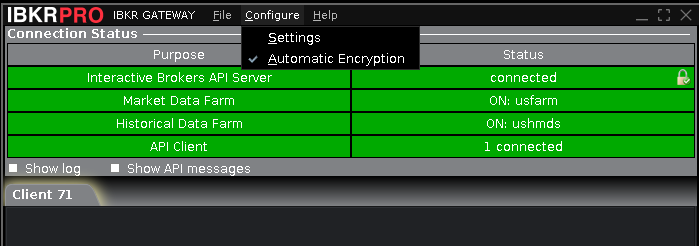
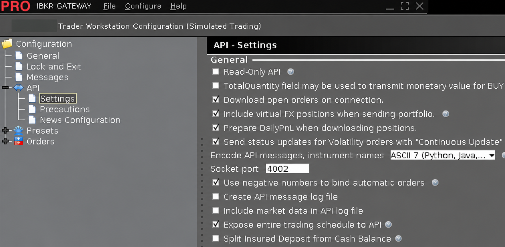
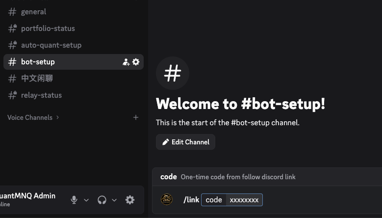

# Auto Quant setup, step by step

This guide is for the separately supplied native `follow-executor` kit. For the combined `follow-stack` kit, use [the beginner container guide](SETUP.md). Do not use these steps to migrate an existing installation.

English | [简体中文](SETUP_NATIVE.zh-CN.md)

This guide helps you install Auto Quant on a cloud computer, connect your IBKR
**paper trading account**, and optionally receive private Discord messages.
Paper trading uses a simulated account. Start there before considering real money.
You do not need programming experience or access to the source-code repository.

**Prefer an AI assistant to guide you?** Open [Start here](../START_HERE.md) and
paste its prompt into Codex, Claude Code or another agent with terminal access.
The assistant can read this guide, run supported steps and ask for information
as needed. Personal logins and phone approval still need you. Its checkpoints
and instructions for resuming are in [the agent guide](AGENT_SETUP.md).
The steps below remain available for manual setup.

You will use **your own computer** to set up a second computer hosted by Oracle.
Once running, the Oracle computer can stay on when your own computer is off.

| Name in this guide | What it means |
| --- | --- |
| OCI / Oracle Cloud | The company and website hosting your cloud computer |
| Instance / VM | Your cloud computer, running Ubuntu |
| Terminal | A window where you paste instructions, called commands |
| SSH | The secure connection from your computer to Ubuntu |
| IB Gateway | IBKR's program that connects Auto Quant to your account |
| IBC | The helper that opens Gateway and requests your mobile login approval |
| Executor / follower | The Auto Quant program that follows signals in your account |

Follow the steps in order. Paste **one command line at a time**, press **Enter**,
and wait for it to finish. Copy only the command, not a sample prompt such as
`ubuntu@auto-quant:~$`. A password prompt may show no letters or dots while you
type; that is normal. Stop at an error instead of continuing to the next step.

- [1. Gather your accounts and download](#prepare)
- [2. Create your Oracle cloud computer](#cloud)
- [3. Copy the download to Ubuntu](#transfer)
- [4. Install Auto Quant](#install)
- [5. Set up IBKR login and mobile approval](#gateway)
- [6. Enter your Auto Quant settings](#follower)
- [7. Connect Discord messages](#discord)
- [8. Check, then start paper trading](#paper)
- [9. Use it day to day](#daily)
- [10. Back up or update](#update)
- [11. Solve common problems](#help)

<a id="prepare"></a>

## 1. Gather your accounts and download

**Where: your own computer and phone.**

Ask Auto Quant for these four items and keep them somewhere private:

| Item | What it is for |
| --- | --- |
| `follow-executor-0.3.0-ubuntu24.04-arm64-cp312.tar.gz` | The installation download; keep the filename as supplied |
| The matching `.tar.gz.sha256` file | A small file that lets Ubuntu check the download is complete and unchanged |
| Your personal relay token and expected leader public-key fingerprint | Your private access code and the identifier used to check the signal provider |
| An Auto Quant Discord invitation | Needed only if you want private transaction messages |

Save **both download files** in your computer's **Downloads** folder. Leave the
`.tar.gz` compressed; you will open it on Ubuntu. Obtain both files through Auto
Quant's trusted download channel.

Also prepare your **IBKR paper trading login**, its **account ID** and **IBKR
Mobile** on your phone. Make sure your account supports the intended futures and
**IB Key / mobile push approval**. You will need your username/password to log in,
and the separate account ID (for example `DU1234567`) when configuring Auto Quant.
Use an account dedicated to following; unrelated MNQ/NQ orders or positions can
cause Auto Quant to stop and ask for review.

First complete [IBKR additional-account and secondary-login preparation](IBKR_ACCOUNT_SETUP.md).
Use distinct usernames for Gateway and phone trading, and verify paper access.
The [OCI guide](OCI_ARM.md) recommends San Jose for new accounts, the offline
authenticator checkbox before scanning, and a payment method plus confirmed
Pay As You Go plan **before VCN creation**.

**Ready to continue:** you have the two files, your Auto Quant access details,
and a paper account you can log in to. You will install a remote-desktop viewer
on your own computer in step 5.

<a id="cloud"></a>

## 2. Create your Oracle cloud computer

**Where: your own computer's browser, then its terminal.**

Open the [illustrated Oracle setup walkthrough](OCI_ARM.md). It shows how to:

1. Create your Oracle account, select the recommended San Jose Home Region,
   complete MFA, and verify Pay As You Go with a payment method before VCN creation.
2. Create the network and allow only your computer to connect.
3. Create **Ubuntu 24.04 LTS ARM64** on **Ampere A1**.
4. Save the private SSH key and connect to Ubuntu.

That walkthrough includes official screenshots of signup, networking, the
instance page, Ubuntu selection and key download. A starting allocation is
**2 OCPUs / 12 GB memory**; review Oracle's charges and available capacity before
creating the instance. Free availability is not guaranteed.

If your VM already exists, use the walkthrough's [connection](OCI_ARM.md#oci-connect)
and [verification](OCI_ARM.md#oci-check) steps. This download requires **Ubuntu
24.04**, **ARM64/aarch64** and **Python 3.12**. Keep using Python 3.12 for this
release. Internet access is required for installation.

**Ready to continue:** you have an Ubuntu connection open, with a prompt similar
to `ubuntu@auto-quant:~$`. Call this **Window A — Ubuntu**. Keep it open.

<a id="transfer"></a>

## 3. Copy the download to Ubuntu

You will use **two terminal windows**. This is the part where it is easiest to
paste a command into the wrong computer:

| Window | Controls | Use it for |
| --- | --- | --- |
| **A — Ubuntu** | The cloud computer; prompt usually starts with `ubuntu@` | Install and run Auto Quant |
| **B — Your computer** | Your laptop/desktop; a new PowerShell or Terminal window | Send the download and later open the remote-desktop connection |

**In Window A — Ubuntu**, create a folder for the download:

```bash
mkdir -p ~/Downloads
```

**Open Window B on your own computer.** Windows: open another PowerShell window.
Mac: open another Terminal window. Do not run SSH in it yet. The commands below
assume the two download files and **auto-quant.key** from the OCI walkthrough are
all in your computer's Downloads folder.

```bash
cd ~/Downloads
```

Replace `YOUR_OCI_PUBLIC_IP` with your instance's **public IPv4 address**, then
paste the following as **one line**. `scp` means “copy files securely.” Keep the
colon and `Downloads/` at the end.

```bash
scp -i ./auto-quant.key follow-executor-0.3.0-ubuntu24.04-arm64-cp312.tar.gz follow-executor-0.3.0-ubuntu24.04-arm64-cp312.tar.gz.sha256 ubuntu@YOUR_OCI_PUBLIC_IP:Downloads/
```

Wait for both transfers to finish. If prompted on this first connection, check
the address against your instance before accepting it.

**Back in Window A — Ubuntu**, check the download:

```bash
cd ~/Downloads
sha256sum --check follow-executor-0.3.0-ubuntu24.04-arm64-cp312.tar.gz.sha256
```

You should see the archive's name followed by **OK**. This check detects an
incomplete or changed file; you do not need to understand or type its long
checksum number. If it says **FAILED**, stop and download both files again from
Auto Quant. Then unpack the download into its permanent folder:

```bash
mkdir -p ~/auto-quant
tar -xzf follow-executor-0.3.0-ubuntu24.04-arm64-cp312.tar.gz -C ~/auto-quant
cd ~/auto-quant/follow-executor-0.3.0-ubuntu24.04-arm64-cp312
./install.sh --verify-only
```

**Ready to continue:** the last command says **Release checksums, OS, architecture
and Python bytecode version verified.** Use a fresh folder for this installation;
do not mix it with old files. Keep this folder at the same location afterward.

<a id="install"></a>

## 4. Install Auto Quant

**Where: Window A — Ubuntu, in the folder from step 3.**

```bash
./install.sh
```

The installer downloads the needed software. Let it finish; scrolling text is
normal. If Ubuntu asks for a sudo password, that is the Ubuntu user's password,
not your Oracle or IBKR password. A new OCI Ubuntu account normally uses its SSH
key and may not ask for one.

Use the commands exactly as shown. Do **not** put `sudo` before `./install.sh`,
`./follow` or `./scripts/gateway-desktop.sh`; they request the access they need.

**Ready to continue:** you see **Installed** and **Trading has not been started**.
Installing does not place orders. Your account details will be entered later.

<a id="gateway"></a>

## 5. Set up IBKR login and mobile approval

**Optional container pilot:** on a compatible paper-account test machine, you can replace this
whole step with [the Gateway container guide](GATEWAY_DOCKER.md), then return at
step 6. It downloads a pinned Gateway image and avoids the manual installer and
full Ubuntu desktop. The steps below apply to the native kit. New combined-kit customers use
[SETUP.md](SETUP.md). Preserve the selected backend when resuming an existing setup.

You will briefly use a remote desktop to see Gateway's login window. This is the
Ubuntu computer's screen, displayed on your own computer.

### 5a. Prepare the desktop

**In Window A — Ubuntu:**

```bash
./scripts/gateway-desktop.sh
```

Choose and confirm a **VNC password** when asked. This is a new password for the
remote desktop, not your IBKR password. If asked for a view-only password, choose
**n**; you need to click and type in the desktop. Wait for the helper to finish.
It downloads and checks the supported Gateway installer.

**On your own computer**, install a VNC viewer if you do not have one. You can use
[TigerVNC Viewer from its official website](https://tigervnc.org/); choose a build
for your own computer's operating system. You only need the viewer on your laptop.

**In Window B — Your computer**, still in Downloads, run this with your public
IP substituted:

```bash
ssh -i ./auto-quant.key -N -L 5901:127.0.0.1:5901 ubuntu@YOUR_OCI_PUBLIC_IP
```

This opens a private connection for the desktop. **A blank window that stays busy
is normal. Leave it open.** Do not type later commands into this window while the
connection is running. Do not open port 5901 in Oracle's firewall.

Open the viewer. In **TigerVNC**, connect to **localhost::5901** (two colons specify
the port). Viewers with separate boxes use host **localhost**, port **5901**.
Enter the **VNC password** you just created.

**Checkpoint:** you can see an Ubuntu desktop. If you cannot, use the troubleshooting
table at the end before continuing.

### 5b. Install Gateway inside the Ubuntu desktop

**Where: the remote desktop shown in the VNC viewer.** Open **Applications →
Terminal Emulator** (or the desktop's terminal icon), then run:

```bash
sh ~/Downloads/ibgateway-latest-linux-arm.sh
```

Follow the installer, review IBKR's terms and accept them if you agree. Keep the
installation under your Ubuntu user, normally **~/Jts/ibgateway/1051**. Record the
path if you choose another. This release uses **Gateway 10.51 ARM64**.

If the installer opens Gateway, **close that Gateway window** before the next
step. Keep the Ubuntu desktop running; do not log out of it. If you already have
this exact Gateway version installed under your Ubuntu user, use its installation
path instead of installing a second copy.

### 5c. Choose the account and approval time

**Back in Window A — Ubuntu:**

```bash
./follow gateway configure
```

A value in square brackets is the suggested answer. Press **Enter** to accept
it, or type a replacement. For a new paper setup:

| Prompt | What to enter |
| --- | --- |
| Gateway installation directory | Press Enter if you used `~/Jts/ibgateway/1051`; otherwise enter the path you recorded |
| Account mode | `paper` |
| Schedule timezone | Press Enter for `America/New_York` |
| Daily automatic restart | Press Enter for `23:45`, or choose a time outside your trading session |
| Sunday mobile approval time | Press Enter for `12:00` |
| IBKR login username / password | Your paper login details; input is hidden |

The default Sunday appointment is **12:00 noon US Eastern**, with daily restarts
at **23:45 Eastern**. Both follow EST in winter and EDT in summer. Your laptop's
or VM's timezone does not change that schedule. For example, noon Eastern is
normally **9:00 a.m. US Pacific**. Existing saved schedules remain your defaults
when reconfiguring. [More about changing the schedule](IBC.md)

IBC saves the IBKR login privately on **your own VM** so it can open Gateway and
request authentication. These credentials are not sent to Auto Quant or Discord.
You still approve the request on your phone. Other authentication methods, such
as passkeys, may need additional actions in the remote desktop.

### 5d. Start Gateway and approve your phone

**In Window A — Ubuntu:**

```bash
./follow gateway start
./follow gateway logs
```

Approve the notification in **IBKR Mobile on your phone**. Watch Gateway in the
remote desktop and complete any remaining IBKR questions. If it asks to confirm
automatic restart, click **OK** once.

<a id="gateway-api"></a>

#### Check the Gateway API settings

**Where: the IBKR Gateway window in your VNC remote desktop.** Use **IB API**
mode. These settings let Auto Quant connect to Gateway and submit orders.

1. At the top of the Gateway window, click **Configure**, then **Settings**.

   

2. In the left-hand list, expand **API**, then click **Settings** underneath it.

   

   The screenshot shows a paper account. The settings window may be titled
   “Trader Workstation Configuration” even when opened from IB Gateway.

3. Check the following settings. If a box already has the correct state, leave it
   as it is; clicking it again would reverse the setting.

| Setting | Paper setup |
| --- | --- |
| Read-Only API | **Unchecked**: the little square must be empty so the program can submit orders |
| Socket port | **4002** for this paper setup |
| Allow connections from localhost only | **Checked**; scroll down if needed |
| Trusted IPs | **127.0.0.1**; scroll down if needed |

The localhost and trusted-IP settings are below the area shown in the screenshot.

**No “Enable ActiveX and Socket Clients” checkbox?** This is normal in IB Gateway:
API connections are enabled automatically. There is no ActiveX option to switch
on in this Gateway screen. [IBKR explanation](https://www.interactivebrokers.com/campus/trading-lessons/installing-configuring-tws-for-the-api/)

Click **Apply**, then **OK** to save. If the buttons are outside the visible area,
enlarge the settings window or move it up in the remote desktop. Leave other
options at their existing values.

IBC sets the API port and trusted address automatically; inspect them on this first
login. Keep ports **4001, 4002 and 5901** closed to the public Internet. Live mode
uses 4001, but keep paper mode for this walkthrough.

Press **Ctrl+C in Window A** to leave the scrolling log display. This does not stop
Gateway. **Ready to continue:** Gateway is logged into your paper account and no
login dialog is waiting. A “running” service alone does not prove login succeeded.
Gateway login itself does not start Auto Quant trading.

<a id="follower"></a>

## 6. Enter your Auto Quant settings

**Where: Window A — Ubuntu.**

```bash
./follow configure
```

| Prompt | What to enter |
| --- | --- |
| Account mode | `paper` |
| IBKR account ID | The paper account shown in Gateway, for example `DU1234567`; this is **not** your username |
| Sizing | `balance` (default: NQ plus an MNQ remainder from your balance), or `MNQ`/`NQ` for a fixed size, as agreed for your subscription |
| Leverage fraction | With `balance`: your chosen number above 0 and at most 1; `1` follows the leader's full 6x. Optional preview prompts follow; Enter skips them |
| Number of contracts | With a fixed size: your chosen whole number; the suggested value is 1 |
| Personal relay token | The private token supplied by Auto Quant; input is hidden |

The normal provider address and signal stream are already filled in. If Auto Quant
specifically gave you a custom connection, use `./follow configure --advanced`
for the initial setup. You do not need it for the normal service.

**Ready to continue:** the confirmation shows the intended quantity, instrument
and **paper** mode. If you chose the wrong account/mode, stop and follow the
[account-switch instructions](OPERATIONS.md). Re-running this wizard on an existing
setup changes instrument/quantity only; it does not replace the account.

<a id="discord"></a>

## 7. Connect Discord messages (optional)

Skip to step 8 if you do not want Discord messages. **Each follower uses their own
Discord account. You do not create a bot or enter a bot token.**

1. On your own computer or phone, sign in to Discord or create an account.
2. Accept Auto Quant's invitation and open the **Auto Quant** server.
3. Allow direct messages from that server's members in Discord's privacy settings.
4. In **Window A — Ubuntu**, with Auto Quant still stopped, run:

```bash
./follow discord link
```

Read what information will be shared, then type **LINK** if you agree. This includes
positions, trade quantities, entry/exit prices, gross profit/loss, Gateway/service status, liveness heartbeats
and event times. The one-time code appears
**in Window A**, and expires after ten minutes.

5. In Discord, open **Auto Quant → #bot-setup**.
6. Type `/link`, choose the command from **AQ Bot**, and paste the one-time
   code into its **code** field. Submit the slash command. Do not send the code as
   an ordinary channel message.

   

   `xxxxxxx` is only a placeholder. Use the fresh code from **your own Ubuntu
   terminal in Window A**. The **Edit Channel** button shown belongs to the
   server owner's view; followers do not need to edit the channel.

7. Look for the private confirmation and a test message from AQ Bot. Also
   check Discord's message requests.
8. Back in **Window A — Ubuntu**, run:

```bash
./follow discord status
./follow discord enable
```

**Ready to continue:** the test DM arrived and notification enabling succeeded.
If it did not, check the [Discord guide](DISCORD.md) or ask Auto Quant to check
channel access. Linking your account does not start trading.

Once trading starts, trade messages show **LONG**, **SHORT**, or **FLAT** after
confirmed executions. Every FLAT message includes **Gross P/L in USD, before
commissions and fees**, for the completed trade, including partial exits. Stop
placement and trailing-stop changes are silent; a stop fill that closes the
position still produces FLAT. Discord can be delayed; verify positions in IBKR.

AQ Bot also reports Gateway/API or market-data problems, verified recovery,
Auto Quant starts/stops and safety halts, and signal-feed interruptions. Full
Gateway recovery requires completed API reconciliation and confirmed live quote
subscriptions. If the relay receives no service heartbeat for three minutes,
it warns that your service is unreachable; this can indicate a VM, process or
network problem. A normal stop disables that heartbeat monitor. See the
[notification guide](DISCORD.md) for examples and monitoring limits.

Use customer package **0.1.7** with the provider's notification server **0.1.3 or
newer**. Existing customers keep their Discord link when upgrading while flat and
stopped. Preserve the journal and notification database for entry prices and
history. Older packages need this upgrade for LONG/SHORT/FLAT and gross P/L.

<a id="paper"></a>

## 8. Check, then start paper trading

**Where: Window A — Ubuntu.** First run the readiness check:

```bash
./follow check
```

It reads your broker/relay status and may ask IBKR for a margin estimate. **It does
not submit an order that can execute.** The result may look technical; check these
specific fields before continuing. Also compare the account ID you entered in
step 6 with the account shown in Gateway:

| Check | What you need |
| --- | --- |
| `account_type` | `paper` |
| `root` and `quantity`, or `sizing` | The fixed size, or the leverage fraction and per-leg split, you chose in step 6 |
| `leader_key_id` | Matches the fingerprint Auto Quant supplied |
| `problems` | An empty list: `[]` |

If any item is wrong, or the check fails, stop and resolve it. When all checks pass
and you are ready to allow **paper orders**, run the commands below one at a time.
If the status screen shows **(END)**, press **q** to return to the prompt before
running the next command:

```bash
./follow start
./follow service-status
./follow logs
```

**This is the step that starts trading.** It also enables automatic startup after
a VM reboot. An eligible signal may trigger an order immediately; otherwise it
waits for a valid signal. Previously missed or expired entries are skipped.

Press **Ctrl+C** to leave the log viewer; trading continues. Check actual paper
fills and stop orders in IBKR, and DMs if enabled. Do not switch to live because
installation passed: first complete an end-to-end paper run, including login,
orders, stops and reconnection. Use the [operations guide](OPERATIONS.md) for the
separate live-account setup.

**Finished:** Auto Quant is running on the cloud computer. You can close your
local windows when you no longer need them. Close the VNC viewer; do not log out
of the Ubuntu desktop itself.

<a id="daily"></a>

## 9. Use it day to day

To return later, open a terminal **on your own computer** and connect again:

```bash
cd ~/Downloads
ssh -i ./auto-quant.key ubuntu@YOUR_OCI_PUBLIC_IP
```

After the prompt changes to Ubuntu, return to the installation folder:

```bash
cd ~/auto-quant/follow-executor-0.3.0-ubuntu24.04-arm64-cp312
```

Then use the commands below **on Ubuntu**:

| What you want | Command |
| --- | --- |
| See whether Auto Quant is running | `./follow service-status` |
| Read recent activity | `./follow logs` — press Ctrl+C when finished |
| Read the saved local status or halt reason | `./follow status` — this is not a fresh broker position report |
| Check Discord linkage | `./follow discord status` |
| Check Gateway's service and saved schedule | `./follow gateway status` — verify login separately |
| Stop Auto Quant and disable its automatic startup | `./follow stop` |

**Stopping Auto Quant does not close positions or cancel orders.** Check actual
positions in IBKR. For planned changes, wait until there are **no open positions
and no working orders**. This is called being **flat**. While stopped, Auto Quant
cannot update stops or manage timed exits. Do not use `./follow resume` as an
ordinary restart; recovery can adopt and close broker positions.

Expect a phone approval request for the scheduled **Sunday noon Eastern** login,
and possibly after a VM restart or another IBKR authentication request. Approve it
in IBKR Mobile; IBC cannot approve it for you. Keep the VM running during trading.
If login is stuck, reopen the private desktop using step 5a and inspect Gateway.

To change the weekly time, first be flat, then run `./follow stop` and
`./follow gateway stop`. Run `./follow gateway configure` and enter the desired
IANA timezone and 24-hour Sunday time; press Enter for settings you want to keep.
Then run `./follow gateway start`, approve any login, run `./follow check`, and
only then `./follow start`. The [IBC guide](IBC.md) explains allowed times and recovery.

To change quantity, while flat and with Gateway logged in, use:

```bash
./follow stop
./follow settings --quantity 2
./follow check
./follow start
```

The value **2** is an example, not a recommendation. To change the instrument too,
use `./follow settings --root NQ --quantity 1`. If a change is refused, the old
settings are retained; read the error before trying again.

<a id="update"></a>

## 10. Back up or update

Your installation folder holds the program. Your private settings and trade
history are in two separate Ubuntu folders:

| Folder | Contains |
| --- | --- |
| `~/.config/follow-executor/` | Settings, relay token, IBC login and Gateway/desktop configuration |
| `~/.local/state/follow-executor/` | Trade history, pending notifications and associated database files |

Keep **both folders together in a private backup**. They contain sensitive details;
do not upload them to a public support channel. If you need help copying folders,
ask Auto Quant to walk you through a private backup before updating.

For an update, confirm there are no positions or working orders in IBKR. Run
`./follow stop`, then `./follow gateway stop`, and make the backup while stopped.
Get the new archive and checksum from Auto Quant, repeat step 3 with its **new
version filenames**, and install it in its own **new version folder**.

Run the new folder's `./install.sh`; it reuses your saved settings/history and
updates the startup paths. Do not copy the old `.venv` folder. Start Gateway,
approve login, run the check and start Auto Quant from the new folder, in that
order. Keep the previous release until the new one is verified.

Never delete the trade history to clear an error or run two copies on the same
account. Ask Auto Quant before rolling back; restoring old trade history after
newer trades can make the saved state incorrect. If upgrading from version 0.1.0,
which used manual Gateway login, see the [IBC migration instructions](IBC.md).

<a id="help"></a>

## 11. Solve common problems

| What you see | Next step |
| --- | --- |
| `./follow: No such file or directory` | On Ubuntu, run the installation-folder `cd` command in step 9. |
| SSH times out or rejects the key | Use the [OCI troubleshooting table](OCI_ARM.md#oci-help). |
| Checksum or verification fails | Stop; get a fresh matching download/checksum and confirm Ubuntu 24.04 ARM64 / Python 3.12. |
| VNC cannot connect | Keep Window B's SSH connection open; check `localhost::5901` in TigerVNC and use your VNC password. Do not open a public VNC port. |
| The SSH tunnel says “Address already in use” | A previous tunnel may still be open. Close that old tunnel and retry; do not change Oracle's firewall. |
| No IBKR phone prompt or Gateway connection refused | Inspect Gateway in the remote desktop and use `./follow gateway logs`; confirm paper login and port 4002. |
| Relay unauthorized | Ask Auto Quant to check your subscription/token. Do not post the token. |
| No `/link` command or test DM | Use #bot-setup, select AQ Bot, request a fresh code, and check Discord DM permissions/message requests. |
| The check shows problems, or trading stops | Read `./follow logs` and `./follow status`, verify the account in IBKR, then ask for help with the exact error. Do not delete state files or repeatedly run resume. |

When asking for help, include the **step number**, whether you were on **your own
computer or Ubuntu**, and the **error text**. Hide login details, private keys,
relay tokens and one-time codes from screenshots.

Further reading: [IBC and mobile approval](IBC.md), [Discord](DISCORD.md),
[operations and account switching](OPERATIONS.md), [execution behavior](EXECUTOR.md).

## Source code and license

The customer executor is GPL-3.0-or-later. Matching application source is included
in the kit; dependency source is available on the same release page. You do not
need to read or compile it to install. See [source and licensing](SOURCE.md).
